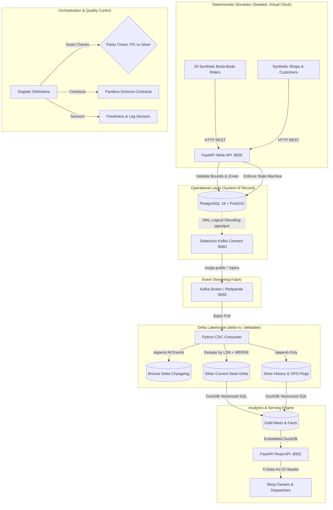

# Mzigo: Last-Mile Delivery Platform with Change Data Capture

[](https://github.com/paulakelo/mzigo/actions/workflows/ci.yml)
[](LICENSE)
[](pyproject.toml)
[](docker-compose.yml)
[](https://delta.io/)
[](https://duckdb.org/)
[](https://dagster.io/)

*Portfolio project 3 of 3 | Backend + CDC + lakehouse + serving | FastAPI, Postgres/PostGIS, Debezium, Kafka, Delta (delta-rs), DuckDB, Dagster | $0 stack*

---

## 1. Overview & Problem Statement

In Nairobi's bustling commerce ecosystem, social commerce shops selling on WhatsApp and Instagram rely on independent **boda-boda** (motorcycle) riders for last-mile delivery. However, merchants and dispatchers face chronic operational opacity:
- Which riders are fastest and most reliable?
- Which delivery zones experience the highest drop-off failure rates?
- How much time is spent waiting at pickup vs. in transit?
- Which orders breached customer delivery Service Level Agreements (SLAs)?

While the operational database records every status change and GPS ping, running analytical aggregation queries directly against PostgreSQL strains transactional throughput and risks locking tables. Conversely, running nightly batch dumps misses fleeting operational delays and yields stale metrics.

### The Solution: Mzigo

**Mzigo** solves this problem via a dual-engine architecture:
1. **Operational Backend (OLTP)**: A lightweight FastAPI service backed by PostgreSQL 16 and PostGIS records dispatches, strictly enforces status state machines, validates Kenya geographic boundaries, and computes point-in-polygon zone assignments at write time.
2. **Data Platform (CDC + Lakehouse + Serving)**: Captures transaction log changes via **Debezium** (pgoutput logical replication) and streams them through **Kafka**. A Python consumer writes an immutable change log to **Delta Lake** (Bronze), maintains current state via **LSN-guarded Delta MERGE** without Apache Spark (Silver), computes analytical marts via **DuckDB** (Gold), and serves metrics through an isolated **Read API** with real-time freshness headers.

```
Portfolio Context:
  • dukastack : Batch Lakehouse (DuckDB + dbt + Dagster + Parquet/Delta)
  • Rekon     : Streaming Webhook Reconciliation (Kafka + Spark Streaming + Delta)
  • Mzigo     : Operational CDC Replication & Lakehouse (PostgreSQL WAL + Debezium + delta-rs + DuckDB + Serving API)
```

---

## 2. End-to-End Architecture



---

## 3. Data Layers & Storage Specifications

| Layer | Technology | Contents | Write Pattern & Guarantees |
| :--- | :--- | :--- | :--- |
| **OLTP** | PostgreSQL 16 + PostGIS | Normalized operational tables (`deliveries`, `zones`, `shops`, `riders`, `pings`) | ACID transactions, `REPLICA IDENTITY FULL`, PostGIS spatial indexing. |
| **Bronze** | Delta Lake (`delta-rs`) | Raw Debezium envelopes (`op`, `before`, `after`, `source.lsn`, `ts_ms`, `topic`, `offset`) | Append-only changelog, partitioned by `event_date`. Base for full rebuilds. |
| **Silver** | Delta Lake (`delta-rs`) | Current state per table + append-only transition history and GPS pings | Monotonic LSN-guarded `MERGE` (`source.lsn > target._lsn`). Soft deletes (`deleted_at = ts_ms`). |
| **Gold** | DuckDB + Delta | Delivery lifecycle facts, route segments, rider scorecards, zone stats, SLA breaches | Incremental and snapshot SQL transformations validated against Pandera contracts. |
| **Serving**| FastAPI + DuckDB | Low-latency read endpoints with `X-Data-As-Of` freshness headers | Read-only; completely isolated from PostgreSQL OLTP database. |

---

## 4. Key Business Questions Answered

| Question ID | Analytical Question | Target Model | Serving Endpoint |
| :--- | :--- | :--- | :--- |
| **Q-1** | What is the full, verified status timeline of a given delivery? | `fct_delivery_lifecycle` | `GET /deliveries/{id}/timeline` |
| **Q-2** | Which boda-boda riders are fastest, safest, and most reliable? | `mrt_rider_scorecard` | `GET /riders/{id}/scorecard` |
| **Q-3** | Which Nairobi delivery zones suffer the highest failure rates and longest transit delays? | `mrt_zone_performance` | `GET /zones/performance` |
| **Q-4** | Which deliveries breached SLA commitments, by how many minutes, and at which stage? | `mrt_sla_breaches` | `GET /analytics/sla-breaches` |
| **Q-5** | Does the analytical Silver lakehouse match the operational source database *right now*? | Parity Check Asset | `make parity` / Dagster Asset Check |

---

## 5. Architectural Decision Records (ADRs)

Key architectural choices and trade-offs borrowed from **dukastack** and **rekon** are documented in [`docs/decisions/`](docs/decisions/):

- [ADR 0001: Debezium CDC via PostgreSQL Write-Ahead Log (WAL)](docs/decisions/0001-debezium-cdc-via-wal.md)
- [ADR 0002: LSN-Guarded MERGE in Silver Current-State via delta-rs](docs/decisions/0002-lsn-guarded-delta-merge-via-deltalake.md)
- [ADR 0003: Write-Time PostGIS Point-in-Polygon Zone Assignment](docs/decisions/0003-write-time-postgis-spatial-validation.md)
- [ADR 0004: Soft Deletes with Change History Retention in Lakehouse](docs/decisions/0004-soft-deletes-with-change-retention.md)
- [ADR 0005: Dynamic Schema Evolution in Delta Tables Without Pipeline Restarts](docs/decisions/0005-dynamic-schema-evolution-without-restarts.md)
- [ADR 0006: Dual-Engine Architecture (PostgreSQL for OLTP, DuckDB for Analytics)](docs/decisions/0006-dual-engine-oltp-postgres-olap-duckdb.md)
- [ADR 0007: Automated Parity Check Asset (PostgreSQL vs. Silver Delta)](docs/decisions/0007-automated-parity-check-source-vs-silver.md)

---

## 6. Chaos Scenarios & Verification Matrix

Mzigo is hardened against operational and streaming failure modes. Full specifications are documented in [`docs/scenarios.md`](docs/scenarios.md):

| ID | Scenario | System Behavior & Verification |
| :--- | :--- | :--- |
| **C-01** | Consumer killed mid-batch | Zero data loss or duplicates; offset committed only after Delta ACID commit; parity passes. |
| **C-02** | Replay from earliest offset | LSN check (`source.lsn > target._lsn`) rejects older/duplicate events; Silver current state unchanged. |
| **C-03** | Intra-batch out-of-order updates | Micro-batch reduced by primary key and ordered by LSN; latest state is merged. |
| **C-04** | Row hard-deleted in PostgreSQL | Bronze retains delete event; Silver sets `deleted_at`; audit history retained. |
| **C-05** | Schema evolved in source (new column) | Consumer detects new field; `deltalake` merges schema without downtime or restarts. |
| **C-06** | Debezium re-snapshotted | Snapshot records merged idempotently; Silver state remains exact. |
| **C-07** | GPS jump outside Kenya / impossible speed | Rejected at API (bounds check) or flagged as speed anomaly (> 120 km/h) in Gold models. |
| **C-08** | Rider location for unassigned order | Rejected at API with HTTP 400 Bad Request; unassigned pings blocked. |
| **C-09** | Illegal status transition attempted | State machine intercepts transition; returns HTTP 409 Conflict. |
| **C-10** | Extended consumer downtime | Replication slot retains WAL; consumer drains backlog on restart; parity passes. |

---

## 7. Milestone Build Records

Mzigo's incremental delivery plan is fully documented across 8 milestone build records in [`docs/milestones/`](docs/milestones/):

- [Milestone 1: Postgres Schema, PostGIS Zones, FastAPI Write API & State Machine](docs/milestones/M1_POSTGRES_SCHEMA_WRITE_API_AND_ZONES.md)
- [Milestone 2: Deterministic Simulator & Synthetic Delivery Fleet](docs/milestones/M2_DETERMINISTIC_SIMULATOR_AND_FLEET.md)
- [Milestone 3: Debezium CDC, Kafka Streaming & Bronze Delta Changelog](docs/milestones/M3_DEBEZIUM_CDC_AND_BRONZE_CHANGELOG.md)
- [Milestone 4: Silver Current-State with LSN-Guarded MERGE](docs/milestones/M4_SILVER_CURRENT_STATE_AND_LSN_MERGE.md)
- [Milestone 5: Parity Verification Check, Rebuild Pipeline & Dynamic Schema Evolution](docs/milestones/M5_PARITY_CHECK_REBUILD_AND_SCHEMA_EVOLUTION.md)
- [Milestone 6: Gold SQL Models, Data Contracts & Dagster Orchestration](docs/milestones/M6_GOLD_SQL_MODELS_AND_CONTRACTS.md)
- [Milestone 7: Isolated Read API, Chaos Test Suite & CI Automation](docs/milestones/M7_READ_API_AND_CHAOS_SUITE.md)
- [Milestone 8: Documentation, Showcase & Project Polish](docs/milestones/M8_CI_PIPELINE_AND_PROJECT_SHOWCASE.md)

---

## 8. Quickstart & Local Setup

### Prerequisites
- Linux / macOS with Docker & Docker Compose
- Python 3.11+
- `uv` (recommended) or standard `python3.11-venv`

### Step-by-Step Execution

1. **Clone the repository**:
   ```bash
   git clone https://github.com/paulakelo/mzigo.git
   cd mzigo
   ```

2. **Initialize Environment**:
   ```bash
   make setup
   source .venv/bin/activate
   ```

3. **Start Core Services** (Postgres/PostGIS, Kafka, Debezium):
   ```bash
   make up
   ```

4. **Launch Application Services**:
   In separate terminals:
   ```bash
   make backend   # FastAPI write API on :8000
   make cdc       # CDC Consumer (Kafka -> Bronze & Silver Delta)
   make serving   # FastAPI read API on :8002
   ```

5. **Run the End-to-End Simulation Demo**:
   ```bash
   make demo
   ```

6. **Verify Data Parity**:
   ```bash
   make parity
   ```

7. **Test Full Lakehouse Rebuild from Bronze**:
   ```bash
   make rebuild
   ```

8. **Execute Automated Test & Chaos Suite**:
   ```bash
   make test
   ```

---

## 9. Interview Talking Points

- **Why CDC beats polling and nightly batch dumps**: Captures every intermediate status change, preserves delete before-images, incurs zero analytical query load on the operational database, and replicates in near real-time.
- **LSN ordering ensures effectively-once semantics**: Because Kafka offers at-least-once delivery, guarding Delta Lake `MERGE` statements with monotonic Log Sequence Numbers guarantees that replayed or out-of-order packets can never overwrite newer state.
- **Why delta-rs over Spark**: By utilizing Rust-backed `deltalake` in Python, Mzigo achieves true ACID transactions, schema evolution, and time-travel on local disk without needing a heavy JVM or Spark cluster, keeping the full stack under an 8 GB RAM laptop budget.
- **Replication Slot Hygiene**: Unmonitored logical replication slots can retain WAL indefinitely if consumers stop, threatening database disk exhaustion. We document monitoring thresholds and recovery procedures.
- **Never Assume—Prove with Parity**: Rather than trusting CDC replication blind, our automated Dagster parity checks compute row counts and deterministic MD5 record hashes across PostgreSQL and Silver, proving zero drift.
