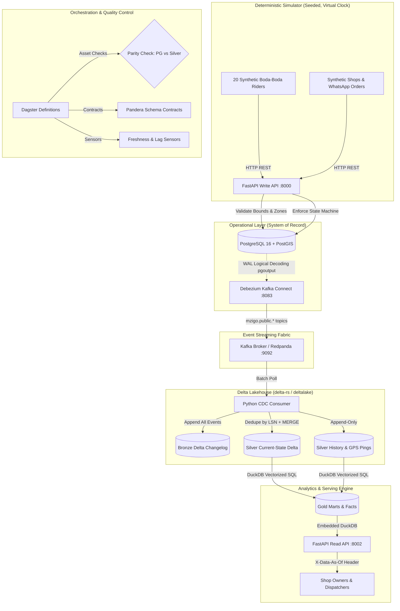

# Mzigo Architecture Specification

Mzigo is a production-grade, zero-dollar ($0) last-mile delivery and Change Data Capture (CDC) platform designed for shop-to-customer logistics via boda-boda motorcycle riders in Nairobi, Kenya.

---

## 1. End-to-End System Flow

---

## 2. Layer-by-Layer Architectural Breakdown

### 2.1 Operational Backend (OLTP)
- **FastAPI**: Validates payloads via Pydantic v2 schemas and handles requests from shops and riders.
- **PostgreSQL 16 + PostGIS**:
  - `zones`: Nairobi delivery polygon boundaries.
  - `deliveries`: Core operational delivery lifecycle with `REPLICA IDENTITY FULL`.
  - `delivery_status_events`: Append-only transition audit table.
  - `rider_locations`: High-frequency rider GPS coordinate pings.
- **State Machine**: Enforces strict transitions:
  `created` ➔ `assigned` ➔ `picked_up` ➔ `in_transit` ➔ (`delivered` | `failed`). Illegal transitions return HTTP 409.
- **Geospatial Point-in-Polygon**: Uses PostGIS `ST_Contains` to match pickup and drop-off coordinates to Nairobi zones synchronously during order creation. Rejects coordinates outside Kenya bounding box (`-4.7` to `5.1` lat, `33.8` to `41.9` lon).

### 2.2 Change Data Capture (CDC)
- **Debezium (Kafka Connect)**: Reads PostgreSQL WAL entries via `pgoutput` plugin.
- Emits structured JSON events into Kafka topics:
  - `mzigo.public.deliveries`
  - `mzigo.public.delivery_status_events`
  - `mzigo.public.rider_locations`
- Each envelope preserves:
  - `op`: Operation type (`c` = insert, `u` = update, `d` = delete, `r` = snapshot read).
  - `before`: Pre-change row state (captured via `REPLICA IDENTITY FULL`).
  - `after`: Post-change row state.
  - `source.lsn`: PostgreSQL Log Sequence Number (monotonic transaction ordering).
  - `source.ts_ms`: Transaction commit timestamp.

### 2.3 Lakehouse Layer (Delta Lake via `delta-rs`)
- **Bronze (Raw Changelog)**:
  - Partitioned by `event_date`.
  - Immutable append-only log storing the exact Debezium envelope, topic, partition, offset, and LSN.
  - Foundation for complete system rebuilds (`make rebuild`).
- **Silver (Current State & History)**:
  - `silver_deliveries`: Reduced intra-batch by primary key and applied using Delta Lake `MERGE`.
    Guard condition: `WHEN MATCHED AND source.lsn > target._lsn THEN UPDATE`.
  - `silver_delivery_status_events`: Append-only transition log.
  - `silver_rider_locations`: Append-only GPS ping stream.
  - Soft-deletes: When `op == 'd'`, the target row sets `deleted_at = source.ts_ms` instead of physical deletion.
  - Schema Evolution: Dynamically merges incoming schema differences via `schema_mode="merge"`.

### 2.4 Analytics Layer (DuckDB + Pandera)
- **DuckDB**: Fast, in-process columnar SQL engine querying Delta tables directly on disk without JVM overhead.
- **Gold Models**:
  - `fct_delivery_lifecycle`: One row per delivery, computing dwell times per status, total trip duration, and SLA compliance.
  - `fct_route_segments`: Consecutive GPS ping pairs computing Haversine distance, elapsed seconds, and speed. Flags anomalies (> 120 km/h).
  - `mrt_rider_scorecard`: Daily metrics per rider: delivery count, average transit duration, failure rate, and speed anomalies.
  - `mrt_zone_performance`: Daily metrics per zone: volume, median duration, and failure rate.
  - `mrt_sla_breaches`: Details for deliveries that breached their SLA target, pinpointing the bottleneck stage.
- **Pandera Contracts**: Enforces strict schema, non-nullability, and value domain validation before serving.

### 2.5 Serving Layer (Read API)
- Dedicated FastAPI service running on port 8002.
- Queries DuckDB over Delta tables.
- **Never connects to PostgreSQL**, ensuring total isolation between OLTP write workloads and analytical read queries.
- Exposes `X-Data-As-Of` header reflecting the timestamp of the latest replicated CDC event.

### 2.6 Orchestration & Data Quality (Dagster)
- **Asset Graph**: Materializes Gold facts and marts on demand or on schedule.
- **Parity Check Asset**: Compares active row counts and deterministic MD5 row-hashes between PostgreSQL and `silver_deliveries`. Fails loudly on any drift.
- **Maintenance Jobs**: Automated `OPTIMIZE` (file compaction) and `VACUUM` (old version cleanup) for Delta tables.
