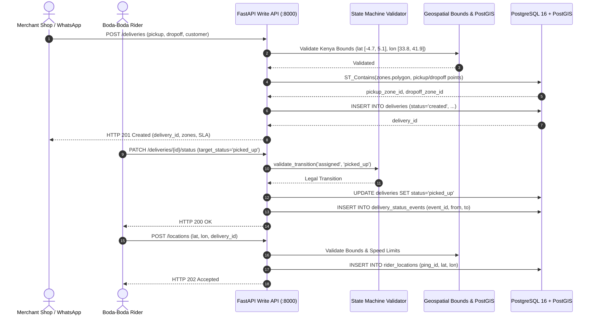

# Milestone 1: Postgres Schema, PostGIS Zones, FastAPI Write API & State Machine

## 1. Context & Objectives

The goal of **Milestone 1 (M1)** is to establish the operational system of record (OLTP) for Mzigo. The operational backend must handle order creation from merchant shops, assign deliveries to boda-boda riders, record real-time rider GPS coordinates, and strictly enforce the delivery lifecycle state machine.

Borrowing lessons from **Dukastack** and **Rekon**:
- **Data Quality at the Source**: Invalid transitions and impossible coordinates outside Kenya are rejected at the HTTP edge with descriptive errors.
- **Geospatial Integrity**: Deliveries are immediately resolved to operational delivery zones via PostGIS `ST_Contains` point-in-polygon queries at write time.
- **CDC Preparedness**: Operational tables (`deliveries`) are configured with `REPLICA IDENTITY FULL` and PostgreSQL logical replication is pre-configured (`wal_level = logical`).

---

## 2. Architecture & Data Flow Diagram



---

## 3. Key Technical Deliverables

1. **PostgreSQL 16 + PostGIS Docker Service**:
   - Configured with `wal_level=logical`, `max_wal_senders=10`, and `max_replication_slots=10`.
   - `postgis/postgis:16-3.4` container.
2. **Schema & Spatial Zones Seed Script (`backend/db/seed_zones.sql`)**:
   - PostGIS extension initialization.
   - Hand-drawn polygons for Nairobi metropolitan zones: CBD, Westlands, Kilimani, Upper Hill, Industrial Area, Eastlands, Karen.
   - Spatial indexing via `GIST (polygon)`.
3. **State Machine (`backend/state_machine.py`)**:
   - `DeliveryStatus` enum: `created`, `assigned`, `picked_up`, `in_transit`, `delivered`, `failed`.
   - `validate_transition()` rejecting non-sequential leaps or transitions out of terminal states with `InvalidStateTransitionError` (HTTP 409).
4. **Geospatial Bounds Validator (`backend/geo.py`)**:
   - Bounds validation for Kenya national coordinates (`-4.7 <= lat <= 5.1`, `33.8 <= lon <= 41.9`).
   - Haversine distance calculator in kilometers.
5. **FastAPI Write Endpoints (`backend/app.py`)**:
   - `POST /deliveries`: Validates coordinates, resolves zones, inserts delivery.
   - `PATCH /deliveries/{id}/status`: Enforces state machine, updates status, logs status event.
   - `POST /locations`: Validates rider coordinate pings and appends to `rider_locations`.
6. **Salted SHA-256 PII Sanitization (`backend/models.py`)**:
   - Masking customer and rider telephone numbers before persisting.

---

## 4. Verification & Testing

- Unit test suite under `tests/unit/`:
  - `test_state_machine.py`: Verifies legal transitions and rejects jumps/retrograde transitions.
  - `test_geo.py`: Verifies in-bounds and out-of-bounds coordinate handling and Haversine math.
  - `test_models.py`: Verifies PII phone hashing stability.
- Run tests:
  ```bash
  make test
  ```
