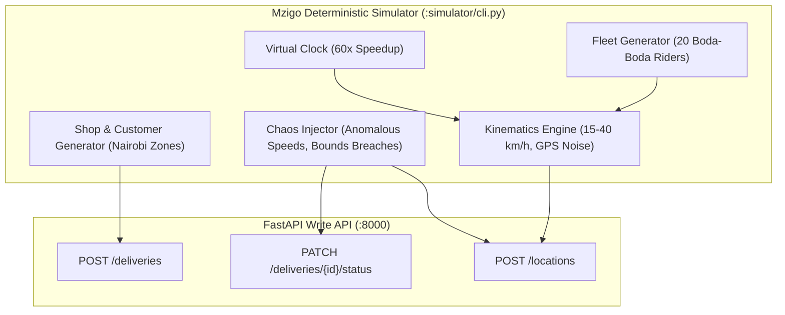

# Milestone 2: Deterministic Event Simulator & Synthetic Delivery Fleet

## 1. Context & Objectives

The goal of **Milestone 2 (M2)** is to build an automated, deterministic simulator that models realistic commercial delivery activity across Nairobi without requiring external APIs or live GPS trackers.

Borrowing from **Rekon** and **Dukastack**:
- **Virtual Accelerated Clock**: Compresses an entire 24-hour business day into 2–3 minutes of real time, driving end-to-end testing without waiting hours.
- **Deterministic Seeded Pseudo-Randomness**: With `--seed 42`, the exact same delivery routes, failure anomalies, and timings are generated every run, ensuring 100% reproducible testing.
- **Realistic Kinematics**: Boda-boda riders travel along noisy paths at 15–40 km/h, posting GPS pings every simulated 10–30 seconds.

---

## 2. Architecture & Kinematics Flow



---

## 3. Key Technical Deliverables

1. **Virtual Clock (`simulator/clock.py`)**:
   - Event-time progression with arbitrary speedup factors (default: 60x).
   - Time advancement hooks for deterministic interval simulation.
2. **Rider Kinematics Engine (`simulator/riders.py`)**:
   - Models 20 distinct synthetic boda-boda riders with assigned start locations across Nairobi zones.
   - Interpolates geographic paths between pickup points and drop-off points with Gaussian GPS jitter (simulating urban canyon effects).
3. **Delivery Lifecycle Walker (`simulator/deliveries.py`)**:
   - Automatically walks generated orders through:
     `created` ➔ `assigned` ➔ `picked_up` ➔ `in_transit` ➔ `delivered` (or `failed`).
   - Probabilistic status durations: 5–15 mins for pickup, 10–35 mins for transit, 5% natural delivery failure rate (customer unreachable / wrong address).
4. **Chaos Scenario Injection (`simulator/chaos.py`)**:
   - Out-of-bounds GPS ping injection (London coordinates) to verify API rejection.
   - Teleportation jump (> 120 km/h) to verify downstream Gold speed anomaly flagging.
   - Retrograde status update attempt to verify state machine rejection (HTTP 409).
5. **Simulator CLI (`simulator/cli.py`)**:
   - Commands:
     - `make demo`: Runs a full compressed operational cycle.
     - `python -m simulator.cli stream --riders 20`: Real-time streaming generator.
     - `python -m simulator.cli chaos`: Runs specific chaos injection routines.

---

## 4. Verification & Proof of Done

- Verify simulator runs in demo mode:
  ```bash
  python -m simulator.cli demo --riders 20 --seed 42
  ```
- Inspect simulated deliveries arriving at FastAPI write API with HTTP 201 and 200 responses.
