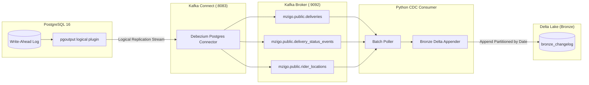

# Milestone 3: Debezium CDC, Kafka Streaming & Bronze Delta Changelog

## 1. Context & Objectives

The goal of **Milestone 3 (M3)** is to liberate operational data from PostgreSQL without querying the database or placing load on transactional tables. By capturing WAL changes via Debezium and streaming them through Kafka, we establish the immutable **Bronze Changelog** in Delta Lake.

Borrowing from **Rekon**:
- **Never Drop Data at the Edge**: Every raw event—including inserts, updates, deletes, and snapshot reads—is preserved verbatim in Bronze Delta tables.
- **ACID Commits on Local Disk**: Raw events are appended using `delta-rs` (`deltalake`) without Spark or Java runtime overhead.
- **Replayability Foundation**: Bronze serves as the permanent source of truth for downstream rebuilds (`make rebuild`).

---

## 2. CDC Pipeline Architecture



---

## 3. Key Technical Deliverables

1. **Debezium Connector Configuration (`cdc/debezium/connector.json`)**:
   - Connector class: `io.debezium.connector.postgresql.PostgresConnector`.
   - Plugin: `pgoutput`.
   - Table inclusion: `public.zones,public.shops,public.customers,public.riders,public.deliveries,public.delivery_status_events,public.rider_locations`.
   - `tombstones.on.delete`: `false` (avoids null-payload tombstone records in Kafka).
2. **Kafka Broker & Topics**:
   - Single-node Kafka KRaft container.
   - Topics created dynamically per table: `mzigo.public.<table_name>`.
3. **Debezium Envelope Extraction**:
   - Extracts standard Debezium payload:
     - `op`: `c` (create), `u` (update), `d` (delete), `r` (snapshot read).
     - `before`: Prior state (captured via `REPLICA IDENTITY FULL`).
     - `after`: New state.
     - `source.lsn`: Monotonic 64-bit Log Sequence Number.
     - `source.ts_ms`: Transaction commit time.
     - `kafka_topic`, `kafka_partition`, `kafka_offset`.
4. **Bronze Delta Appender (`cdc/consumer/bronze.py`)**:
   - Appends all parsed envelopes to `data/delta/bronze_changelog`.
   - Partitioned by `event_date` (`YYYY-MM-DD`).
   - ACID append guarantees via `deltalake.write_deltalake(..., mode="append")`.

---

## 4. Verification & Testing

- Start infrastructure and register connector:
  ```bash
  make up
  ```
- Verify connector status:
  ```bash
  curl -s http://localhost:8083/connectors/mzigo-connector/status | jq .
  ```
- Consume a test batch into Bronze:
  ```bash
  make cdc
  ```
- Verify Bronze Delta table content with DuckDB:
  ```sql
  SELECT op, topic, count(*) FROM delta_scan('data/delta/bronze_changelog') GROUP BY 1, 2;
  ```
