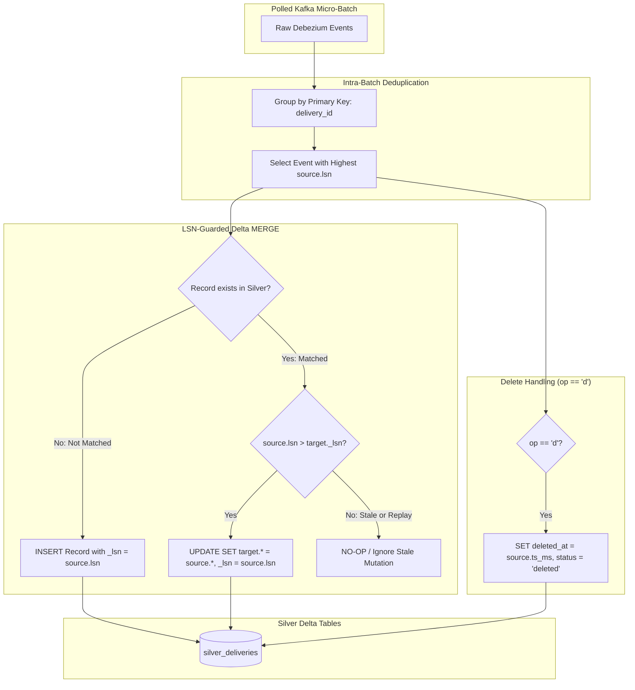

# Milestone 4: Silver Current-State with LSN-Guarded MERGE

## 1. Context & Objectives

The goal of **Milestone 4 (M4)** is to process raw CDC events into clean, queryable **Silver** tables. While Bronze preserves the append-only history of every database mutation, Silver maintains the current snapshot of each business entity while preserving granular status transitions and GPS pings.

Borrowing from **Rekon**:
- **Idempotency Over Everything**: Out-of-order Kafka message deliveries or full stream replays from offset 0 must never regress or corrupt Silver state.
- **Monotonic LSN Guard**: In Rekon, receipts were deduplicated via business keys; in Mzigo, mutations are applied if and only if the incoming PostgreSQL Log Sequence Number exceeds the persisted target `_lsn` (`source.lsn > target._lsn`).
- **Synchronized Commit**: Kafka consumer offsets are committed only after the Delta Lake transaction log successfully commits.

---

## 2. Silver Processing Pipeline & Merge Flow



---

## 3. Key Technical Deliverables

1. **Intra-Batch Reducer (`cdc/consumer/merge.py`)**:
   - Groups records by primary key (`delivery_id`, `rider_id`, etc.).
   - Sorts each group by `source.lsn` ascending, retaining only the terminal state within the micro-batch.
2. **LSN-Guarded Delta MERGE (`cdc/consumer/silver.py`)**:
   - Implements native `delta-rs` table merge:
     ```python
     target_table.merge(
         source=batch_df,
         predicate="target.delivery_id = source.delivery_id",
     ).when_matched_update(
         updates=update_mapping,
         predicate="source.lsn > target._lsn",
     ).when_not_matched_insert(
         updates=insert_mapping,
     ).execute()
     ```
3. **Append-Only Silver History Tables**:
   - `silver_delivery_status_events`: Append-only transition audit log, deduplicated on `event_id`.
   - `silver_rider_locations`: High-volume GPS ping stream, deduplicated on `ping_id`.
4. **Soft-Delete Handling**:
   - Captures `op == 'd'` events.
   - Extracts `before` image from Debezium payload and sets `deleted_at = source.ts_ms`.
   - Does not delete physical rows from Delta, ensuring historical and audit visibility.
5. **Offset Commit Synchronization**:
   - Kafka consumer offset commit occurs strictly after `target_table.merge()` finishes writing its `.json` commit file to `_delta_log/`.

---

## 4. Verification & Testing

- Unit tests in `tests/unit/test_merge.py`:
  - Verify newer LSN overwrites older state.
  - Verify older LSN does not overwrite newer state.
  - Verify duplicate identical events are idempotent no-ops.
  - Verify delete tombstones flag `deleted_at` properly.
