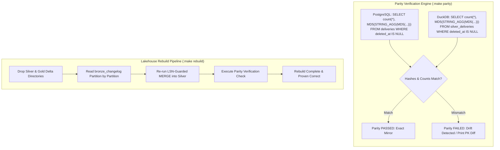

# Milestone 5: Parity Verification Check, Rebuild Pipeline & Dynamic Schema Evolution

## 1. Context & Objectives

The goal of **Milestone 5 (M5)** is to provide cryptographic proof that the lakehouse copy is exact, resilient to schema drift, and 100% reconstructible from raw changelogs.

Borrowing from **Dukastack** and **Rekon**:
- **Never Assume—Prove Parity**: An automated parity check compares row counts and composite hashes of PostgreSQL OLTP vs. Silver Delta Lake, catching silent replication divergence immediately.
- **Full Reconstructibility**: If Silver or Gold is ever corrupted or dropped, `make rebuild` replays Bronze to produce an identical analytical state.
- **Zero-Downtime Schema Evolution**: Source database DDL modifications (such as adding columns) propagate dynamically without pipeline halts.

---

## 2. Parity Check & Rebuild Flow



---

## 3. Key Technical Deliverables

1. **Parity Verification Script (`cdc/consumer/parity.py`)**:
   - Queries PostgreSQL active rows (`deleted_at IS NULL`) and computes composite MD5 hash ordered by primary key.
   - Queries `silver_deliveries` using DuckDB and computes the identical deterministic hash.
   - Prints status table and raises non-zero exit code on drift.
2. **Rebuild Pipeline (`cdc/consumer/rebuild.py`)**:
   - Clears `data/delta/silver_*` and `data/delta/gold_*`.
   - Iterates through `bronze_changelog` in source timestamp / LSN sequence.
   - Reconstructs `silver_deliveries`, `silver_delivery_status_events`, and `silver_rider_locations`.
   - Invokes `run_parity_check()` to guarantee byte-for-byte fidelity.
3. **Dynamic Schema Evolution (`cdc/consumer/schema_evolution.py`)**:
   - Compares incoming batch PyArrow schema against existing Delta schema.
   - Detects newly added columns (e.g. `payment_method`, `notes`).
   - Invokes `deltalake.write_deltalake(..., schema_mode="merge")` to evolve Delta metadata.
4. **Replication Slot Hygiene**:
   - Queries `pg_replication_slots` for `active`, `confirmed_flush_lsn`, and WAL retention bytes.
   - Alerts if slot lag exceeds 500 MB.

---

## 4. Verification & Testing

- Run parity check:
  ```bash
  make parity
  ```
- Test full rebuild:
  ```bash
  make rebuild
  ```
- Schema evolution live test:
  1. Add column in Postgres: `ALTER TABLE deliveries ADD COLUMN payment_method VARCHAR(50);`
  2. Insert new delivery with payment method.
  3. Confirm consumer merges column into `silver_deliveries` without crashing.
