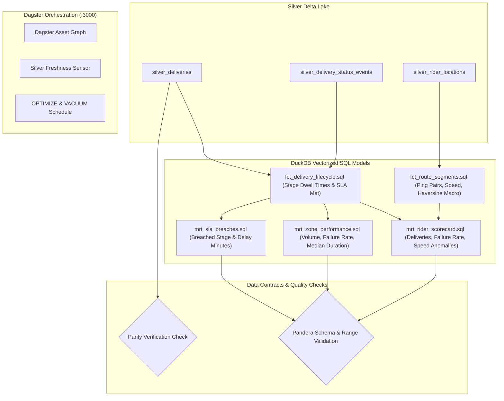

# Milestone 6: Gold SQL Models, Data Contracts & Dagster Orchestration

## 1. Context & Objectives

The goal of **Milestone 6 (M6)** is to transform granular Silver operational records into tested, analytics-ready **Gold** facts and marts answering the core business questions (Q-1 through Q-5).

Borrowing from **Dukastack**:
- **Vectorized In-Process SQL**: Transformations are written in pure SQL and executed using embedded **DuckDB** querying Delta parquet files directly on disk.
- **Strict Data Contracts**: Schemas and numeric bounds are enforced using **Pandera** before exposing models to consumers.
- **Declarative Orchestration**: Dagster orchestrates Gold materializations, executes asset checks, and schedules Delta maintenance (`OPTIMIZE` and `VACUUM`).

---

## 2. Gold Analytical Pipeline & Dagster Graph



---

## 3. Key Technical Deliverables

1. **Haversine Distance Macro (`analytics/macros/haversine.sql`)**:
   - Reusable SQL macro computing great-circle distance between consecutive coordinate pairs in kilometers.
2. **Gold Models**:
   - `fct_delivery_lifecycle`: Computes duration spent in each stage (`created` to `assigned`, `assigned` to `picked_up`, etc.) using window functions, total transit time, and boolean `is_sla_breached`.
   - `fct_route_segments`: Computes `distance_km`, `elapsed_seconds`, `speed_kmh = (distance_km / (elapsed_seconds / 3600.0))`, and flags `is_speed_anomaly = (speed_kmh > 120.0)`.
   - `mrt_rider_scorecard`: Daily aggregate per rider of deliveries completed, failure rate, and total speed anomalies.
   - `mrt_zone_performance`: Aggregates volume, failure rate, and median duration per pickup and dropoff zone.
   - `mrt_sla_breaches`: Details of orders exceeding SLA targets, pinpointing the specific bottleneck stage.
3. **Data Contracts (`analytics/contracts/schemas.py`)**:
   - Pandera schemas validating non-null primary keys, non-negative durations, and valid percentage boundaries (`[0.0, 1.0]`).
4. **Dagster Asset Definitions (`orchestration/`)**:
   - `definitions.py`: Core definition bundle.
   - `assets.py`: Software-defined assets for Gold facts and marts.
   - `checks.py`: Parity asset checks and Pandera contract checks.
   - `sensors.py`: Freshness sensor monitoring Delta table commit timestamps.

---

## 4. Verification & Testing

- Execute Dagster webserver locally:
  ```bash
  make dagster
  ```
- Materialize all Gold assets and verify all asset checks pass.
