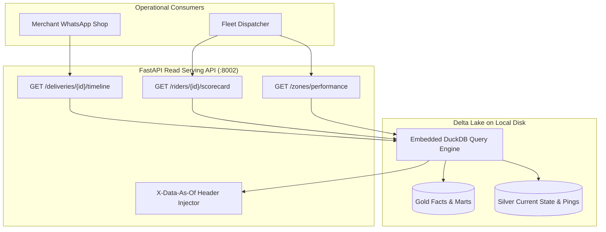

# Milestone 7: Isolated Read API, Chaos Test Suite & CI Automation

## 1. Context & Objectives

The goal of **Milestone 7 (M7)** is to serve analytics to shop owners and dispatchers while protecting transactional database performance, and to subject the entire CDC pipeline to a rigorous 10-scenario chaos test suite.

Borrowing from **Rekon** and **Dukastack**:
- **Zero OLTP Impact**: The Read Serving API is physically forbidden from querying PostgreSQL; all metrics are served via embedded DuckDB over Delta Lake.
- **Data Freshness Transparency**: Responses carry an `X-Data-As-Of` HTTP header reflecting the timestamp of the latest replicated CDC event.
- **Battle-Hardened Chaos Suite**: 10 distinct operational and streaming failure scenarios are codified as automated tests with automated recovery verification.

---

## 2. Serving Architecture & Chaos Matrix Flow



---

## 3. Key Technical Deliverables

1. **Read API Implementation (`serving/app.py` & `serving/queries.py`)**:
   - `GET /deliveries/{id}/timeline`: Returns complete status transition history with durations.
   - `GET /riders/{id}/scorecard`: Returns completed deliveries, average duration, failure rate, and speed anomalies.
   - `GET /zones/performance`: Returns zone volume, median transit duration, and failure rate.
   - `GET /analytics/sla-breaches`: Returns orders breaching SLA with bottleneck stage.
   - Middleware injecting `X-Data-As-Of: <ISO_TIMESTAMP>` derived from `MAX(_lsn_ts)` in `silver_deliveries`.
2. **Chaos Test Suite (`tests/chaos/`)**:
   - `test_c01_kill_consumer.py`: Simulates SIGKILL mid-batch and confirms zero duplicates upon restart.
   - `test_c02_offset_replay.py`: Resets consumer to offset 0 and confirms Silver state remains identical.
   - `test_c03_out_of_order.py`: Injects out-of-order LSNs and verifies highest LSN wins.
   - `test_c04_hard_delete.py`: Deletes row in PostgreSQL and confirms soft-delete flag in Silver.
   - `test_c05_schema_evolution.py`: Adds column dynamically and verifies merge without failure.
   - `test_c06_resnapshot.py`: Re-triggers snapshot and proves idempotency.
   - `test_c07_speed_anomaly.py`: Injects > 120 km/h jump and verifies exclusion in Gold route metrics.
   - `test_c08_unassigned_ping.py`: Confirms API blocks location ping for unassigned order.
   - `test_c09_illegal_transition.py`: Confirms state machine returns HTTP 409.
   - `test_c10_consumer_lag.py`: Simulates backlog accumulation and verifies replication slot recovery.
3. **CI Pipeline (`.github/workflows/ci.yml`)**:
   - Automated workflow running ruff linting, code formatting check, unit tests, and chaos verification.

---

## 4. Verification & Proof of Done

- Launch serving API:
  ```bash
  make serving
  ```
- Test endpoint and inspect freshness header:
  ```bash
  curl -i http://localhost:8002/deliveries/DEL-001/timeline
  ```
- Run complete chaos suite:
  ```bash
  make test
  ```
